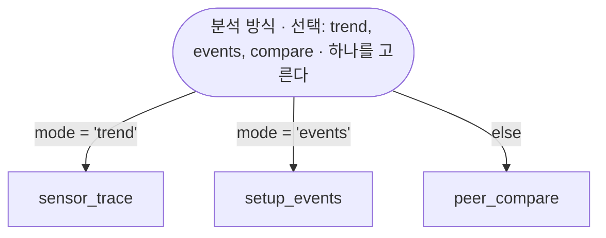

# Consuming and producing with akg from a local CC environment

Phase 2 (design §8.1, §8.2, sections 1-6 below): pull the server's
`rendered/` bundle into a local mirror with `akg sync`, then point
claude-hooks' `keyword-docs` provider at that mirror. claude-hooks itself is
**not modified** — the provider already supports a `params.index` override
(D1), so switching to akg is a 4-line `context.json` edit.

Phase 3 (design §8.1, section 7 below): push changes back to the hub with
`akg propose`, `akg catalog-push` and `akg push` — the CLI's write side.
A program that talks HTTP itself reads section 9.
에이전트 md 의 저장 검사(BE 규칙 미러)는 10절이 적는다.

**Only active documents are in the bundle.** A document can also be `inactive`
— present on the server and readable through the API and dashboard, but not
rendered, not indexed, and so never mirrored or injected (issue #7). That is
where bulk-loaded documents land: the injection budget is two documents per
turn, so a hundred skeletons landing straight into the corpus would crowd out
the ones somebody actually confirmed. An approver activates the few worth
carrying. If a document you expect is missing from the mirror, check its
status before suspecting the sync.

## 1. One-time setup

**Usually none.** A server with anonymous read on — the default, see
`AKG_ANON_READ` — serves the bundle without a credential, so `sync` works with
nothing configured. Skip to §2.

You need a token only if either is true:

- the server sets `AKG_ANON_READ=0`, so reads require a viewer token; or
- you are going to `propose` / `catalog-push`, which are writes and always
  require one (`agent` role or higher).

```sh
mkdir -p ~/.claude/akg
echo "<your-token>" > ~/.claude/akg/token
chmod 600 ~/.claude/akg/token
```

Tokens are issued by the akg server's user admin CLI
(`server/cli/akg-user.mjs`). `AKG_TOKEN` in the environment takes precedence
over the token file if both are set.

## 2. First sync

```sh
node bin/akg.mjs sync --server https://your-akg-server.internal
```

(Or, once `npm link` / a global install exposes the `akg` binary from
`package.json`'s `bin` field: `akg sync --server ...`.)

This writes:

```text
~/.claude/akg/
  meta.json                  # {serverUrl, rev, syncedAt}
  db-schema/  { index.json, docs/*.md }
  msg-format/ { index.json, docs/*.md }
```

`domain-skill/` is only mirrored with `--skills` (skill installation is opt-in
— most sessions only need the injectable docs). After the first sync,
`--server` can be omitted on later runs — it's remembered in `meta.json`.

## 3. Skills: `--skills` installs them where agents look

The mirror is not a place any agent reads, so `--skills` goes one step further
and installs each skill into `~/.claude/skills/<name>/`:

```sh
akg sync --skills --server https://your-akg-server.internal
```

**That one directory covers Claude Code and opencode both.** Claude Code
discovers personal skills there, and it is also one of opencode's global skill
paths (alongside `~/.config/opencode/skills/` and `~/.agents/skills/`), so
there is nothing to install twice and no per-agent configuration. Use
`--skills-dir <dir>` (or `AKG_SKILLS_DIR`) to install somewhere else.

Skills already present at the current rev are left alone, so a sync on a timer
is quiet; a skill you deleted by hand comes back on the next sync.

**akg only touches skills it installed.** `<skills-dir>/.akg-installed.json`
records them. If a skill directory exists that akg did not put there — one you
wrote yourself with the same name — it is neither overwritten nor removed, and
the sync says so on stderr:

```text
akg: skill "fdc-explain-sensor" 설치 건너뜀 — not installed by akg — left untouched
```

Rename one of the two to resolve it. Conversely, when a document leaves the
corpus (archived, or switched to `inactive`), the next `--skills` sync
uninstalls that skill — and only that skill.

Note that a plain `akg sync` **never uninstalls anything**: without `--skills`
the mirror has no `domain-skill/` at all, which is not the same statement as
"the corpus has no skills."

## 4. Switch claude-hooks to read the mirror

Edit `~/.claude/context.json` (design §4 D1):

```jsonc
{
  "providers": {
    "db-schema": {
      "params": { "index": "~/.claude/akg/db-schema/index.json" },
    },
    "msg-format": {
      "params": { "index": "~/.claude/akg/msg-format/index.json" },
    },
  },
}
```

That's the entire integration surface. `keyword-docs`'s matching, dedup, and
injection-budget logic are unchanged — only the index file it reads moves
from claude-hooks' own `~/.claude/context-docs.*.json` to the akg mirror.

After editing, confirm the existing docs still inject: ask a question that
matches one of the migrated documents' keywords in a fresh CC session and
check the prompt got the injected context (or use claude-hooks' own
diagnostics for the `keyword-docs` provider, if available).

## 5. Keeping the mirror fresh

`akg sync` is a normal CLI command — trigger it however fits:

- **Manual**: run it whenever you know the corpus changed.
- **Cron**: e.g. every 15 minutes —
  `*/15 * * * * AKG_SERVER=https://your-akg-server.internal node /path/to/akg/bin/akg.mjs sync`
- **SessionStart hook (fire-and-forget)**: spawn detached with a hard
  timeout so a slow/unreachable server never delays session start (same
  pattern as claude-hooks' `obs-client.mjs` fire-and-forget POST):

  ```js
  import { spawn } from "node:child_process";
  const child = spawn("node", ["/path/to/akg/bin/akg.mjs", "sync"], {
    detached: true,
    stdio: "ignore",
  });
  child.unref();
  setTimeout(() => {
    try {
      child.kill();
    } catch {}
  }, 5000);
  ```

  This is illustrative only — wiring it into an actual claude-hooks
  `SessionStart` hook is out of Phase 2's scope (claude-hooks stays
  unmodified in this phase).

Regardless of trigger, `akg sync` is fail-open: if the server is down or the
network fails, it logs the reason to stderr and exits `0`. The existing
mirror is left exactly as it was — a broken/absent server never blocks a CC
session or removes previously-synced docs. The only exit codes that mean
"you need to fix something" are `1` for an auth failure (401 — your token is
wrong or revoked, or the server has `AKG_ANON_READ=0` and you sent none) or a
config error (no server URL resolvable).

## 6. Manual rehearsal procedure

To verify the full loop end-to-end against a real server before rolling this
out broadly:

1. Start (or confirm running) a rehearsal akg server, e.g.:

   ```sh
   AKG_HOME=<data-dir> AKG_PORT=8791 AKG_HOST=127.0.0.1 \
     node server/main.mjs &
   ```

2. Sync against it:

   ```sh
   AKG_TOKEN=<viewer-token> node bin/akg.mjs sync \
     --server http://127.0.0.1:8791 --mirror /tmp/akg-mirror-check
   ```

   Confirm it prints `synced rev <rev> (N docs)` and that
   `/tmp/akg-mirror-check/db-schema/index.json` (and `docs/*.md`) exist.

3. Point a scratch `context.json` at that mirror (§4 above, using the
   `--mirror` path) and start a CC session with `AKG_MIRROR` / a `--mirror`
   override wired into `context.json`'s `params.index` accordingly, then ask
   a question matching one of the rehearsal server's seeded documents'
   keywords and confirm the injected context shows up.
4. Stop the rehearsal server, re-run `akg sync` against the same
   `--mirror`, and confirm it fails (fail-open, exit 0, stderr explains why)
   **without deleting or corrupting the mirror** — the docs from step 2/3
   must still be readable.

## 7. Producing: `akg propose` and `akg catalog-push`

Unlike `sync`, these are explicit writes a caller asked for — they **fail
closed**: any failure (network, auth, validation, a 404) prints the reason to
stderr and exits `1`, so a calling skill/script can tell the write did not
happen. Both need a token with at least the `agent` role.

### `akg propose <type>/<id> <proposal.json>`

Submits a slot-level proposal to the hub's review queue (`POST
/api/proposals`) — the exit for claude-hooks' `db-schema-propose-codebase`
skill: it hands its proposal here instead of applying it to a local file.

`<type>/<id>` is e.g. `db-schema/t.sensor`. `proposal.json` holds the slots to
propose, keyed by slot address:

```json
{
  "slots": {
    "purpose": {
      "text": "센서 원시값 로그 테이블.",
      "tier": "inferred",
      "evidence": ["ingest.py:12"]
    }
  }
}
```

```sh
node bin/akg.mjs propose db-schema/t.sensor proposal.json
```

Prints `proposed db-schema/t.sensor: <uuid>` (201) or `proposal already
pending: <uuid>` (200 — an identical resubmission dedups against the pending
queue, S8; safe to retry). A human reviews and adopts/rejects it from the
dashboard or `POST /api/proposals/:id/adopt|reject` — this CLI only submits,
it never adopts (adoption is an editor-role action).

### `akg catalog-push <table> <describe.json>`

Pushes a fresh `describe_table` result (agent-db-plugin MCP output shape —
`columns`/`primaryKey`/`foreignKeys`/`indexes`/`numRows`/`lastAnalyzed`/
`tableComment`) into a db-schema doc's `catalog` field (`PUT
/api/docs/db-schema/:id/catalog`) — the exit for claude-hooks'
`db-schema-docs` skill: schema-doc generation moves from "write a local md
file" to "push the raw schema to the hub." This only ever replaces the
**auto/fact** half of the doc (`catalog`); every human-authored slot
(`purpose`, `columnDescs`, `queries`) is left alone, except that a column
which vanished from the new catalog has its `columnDescs` entry dropped (if
still `scaffold`, i.e. never annotated) or marked `deprecated` (if it carried
real text) — never silently deleted.
db-schema 의 `kind` · `columnOrder` · `unusedColumns` 도 그대로 남는다(facts-push 도 같다).
BE 는 `unusedColumns` 의 열을 프롬프트에서 뺀다.

```sh
node bin/akg.mjs catalog-push t.sensor describe.json
```

Prints `catalog pushed: db-schema/t.sensor (rev <rev>)`. The target doc must
already exist — this route never creates one; a 404 means propose (or the
dashboard) needs to create it first.

### `akg push <type>/<id> <file.json|file.md>`

agent 토큰으로 문서 하나를 넣고 고친다. 토큰은 다른 명령과 같다(`AKG_TOKEN` 또는
`~/.claude/akg/token`). 요청은 Bearer 로 가므로 CSRF 헤더가 없다(9절).

- `.json` 은 문서 전체(봉투 + body)다. body 는 `PUT /api/docs/:type/:id` 로,
  links 가 서버와 다르면 `PUT …/links` 로 들어간다. keywords · status · role · origin 은
  서버 값 그대로 두고, 파일과 다르면 stderr 에 적는다.
- `.md` 는 body 가 `{ name, markdown }` 인 타입(md 타입 — voc · unclassified · 화면에서
  등록한 타입 — 과 domain-skill · domain)의 본문 글이다. 서버 문서의 `body.markdown` 만
  바꾸고 봉투 · links 는 그대로 둔다.

흐름:

1. `GET /api/docs/:type/:id` 로 현재 문서와 rev 를 받는다.
2. 문서가 있으면 그 rev 를 `if-match` 로 PUT 한다. `--rev <rev>` 를 주면 그 rev 로 PUT 한다.
3. 문서가 없으면 `--create` 일 때만 `POST /api/docs/:type` 로 만든다. `.md` 로 만든 문서는
   비활성(`inactive`)이다. 화면의 새 문서와 같고, 활성화는 admin 이 한다. `.json` 으로 만든
   문서는 파일의 status 를 따른다.
   `--create` 가 없으면 "없는 문서 — --create 로 만든다" 로 멈춘다.
4. 성공하면 `pushed <type>/<id> (rev …)` 를 찍는다. 미러는 다음 `akg sync` 에서 갱신된다.

- 409(`slot_conflict` · `unknown_base_rev`)는 "서버가 앞섭니다 — sync 뒤 다시" 로 멈춘다.
  기본 rev 는 push 직전에 받은 값이다. 앞서 읽은 판 위에서 고쳤다면 그때의 rev 를
  `--rev` 로 준다. 그러면 그 사이의 남의 수정을 덮지 않고 409 로 멈춘다.
- 400 은 서버의 검증 오류(`validation_failed` 의 details, `edit_rejected` 의 message,
  `unknown_link_target` 의 대상)를 그대로 찍는다.
- `--note <글>` 은 `x-akg-note` 로 가서 이력 메시지 끝에 붙는다.
- `--dry-run` 은 파일만 읽어 모양(schema 가 `<type>/v1` 인지, id 가 맞는지, md 가 비었는지)을
  보고 쓰지 않는다. 토큰 · 서버가 없어도 된다.
- 슬롯은 추정(`inferred`)까지만 들어간다. 본문에 `confirmed` 를 적어도 `inferred` 로
  저장되고, 확정 슬롯을 고치면 `inferred` 로 내려간다. 승격 · 삭제 · 활성화는 admin 이 한다.

```sh
node bin/akg.mjs push voc/line-alarm line-alarm.md --create
node bin/akg.mjs push voc/line-alarm line-alarm.md --note "원인 절 보강"
node bin/akg.mjs push db-schema/t_sensor t_sensor.json --dry-run
```

## 8. Bulk intake: `POST .../batch` and `PUT .../facts`

These are HTTP routes, not CLI subcommands yet — the importer that will call
them (akg-collector) drives them directly.

### `POST /api/docs/:type/batch` (editor or agent)

N documents in **one commit**, for the case `POST /api/docs/:type` was never
meant to carry: a schema import of a few hundred tables.

```json
{ "runId": "import-2026-07-22", "docs": [/* full documents */] }
```

Everything it creates **lands `inactive`**, whatever the payload says. That is
the route's reason to exist: an import cannot reach a prompt, so the decision
to inject stays with an approver (issue #7). Nothing else about the corpus can
be changed here — an id that already exists is a 409 for the whole batch.

It is **all or nothing**. One invalid document rejects the batch with a
per-document reason, and nothing is written; a half-applied import would leave
the caller to work out which half landed.

Chunk it. The body limit is 512 KiB — measured, that is roughly **200
db-schema documents of a dozen columns**. Past it the route answers `413
payload_too_large` with the limit and a note to split, rather than Fastify's
bare "body too large".

`runId` is optional and goes into the commit message, so the audit view shows
which run produced a document. There is no per-document author field for
machine writes, because facts carry no tier and the slots a batch creates are
empty (issue #12, §7-3).

### `PUT /api/docs/:type/:id/facts` (editor or agent)

`catalog-push` for every type, and it **creates the document if absent**
(landing `inactive`, as above). Send a whole body; the route takes the facts
and **ignores the slot values in it entirely**:

- a slot address that survives keeps the value it already had — including
  `confirmed`
- a slot address the new facts introduce starts empty (`scaffold`). A machine
  replacing facts has no standing to assert an interpretation; that is what
  `propose` is for
- a slot address the new facts no longer have is an orphan, and follows the
  rule `catalog-push` set: dropped if never annotated, kept as `deprecated`
  if it carried real text. The response lists them under `orphans`

No per-type branching is involved: a slot is wherever the type schema says
`$ref: common/tiered-value.v1`, so this works the same for `db-schema` and
`msg-format`. `PUT /api/docs/db-schema/:id/catalog` still exists and is
unchanged.

Note that an `agent` token can write facts but cannot read documents back
(`GET` needs `viewer`, and `agent` sits outside that ladder — D6), and cannot
activate anything. That asymmetry is the safety argument for letting machines
write here at all.

## 9. 프로그램이 AKG 에 바로 붙는 법

cc · opencode · 수집기 같은 프로그램은 HTTP 로 AKG 에 바로 붙는다. 길은 Bearer 토큰 하나다.
Bearer 요청은 쿠키를 싣지 않으므로 CSRF 헤더가 없다. `x-csrf-token` 은 브라우저 세션(사람)의
쓰기에만 쓴다. `akg push` 도 이 길을 쓴다.

### 토큰

- **비밀번호 파일 서버**(`FDC_AUTH_KEYCLOAK_ISSUER` 가 빔): `FDC_AUTH_USERS_FILE` 의
  `group: agent` 줄 비밀번호가 그대로 토큰이다. 사람 줄(admin · user)의 비밀번호는 Bearer 로 401 이다.
- **Keycloak 서버**: realm `fdc-voc-agent` 의 client `fdc-voc-agent-a2a` 로 client_credentials
  토큰을 받는다. 그 client 에 agent 역할이 있어야 한다.

```sh
curl -s -d grant_type=client_credentials -d client_id=fdc-voc-agent-a2a -d client_secret="$A2A_SECRET" \
  "$FDC_AUTH_KEYCLOAK_ISSUER/protocol/openid-connect/token" | jq -r .access_token
```

### 요청 모양

- `Authorization: Bearer <토큰>`
- 본문이 있으면 `content-type: application/json`
- 문서를 고치는 쓰기(PUT 문서 · links)에는 `if-match: <rev>`. rev 는 `GET` 응답의 `rev`
  (또는 `etag` 헤더)다. 빠지면 428 이다.
- 이력 메시지를 남기려면 `x-akg-note: <URL 인코딩한 글>`(PUT 문서).
- CSRF 헤더는 보내지 않는다.

### 되는 경로

| 할 일 | 경로 |
| --- | --- |
| 읽기 | `GET /api/docs` · `GET /api/docs/:type/:id`(`?format=md`) · `GET /api/bundle` · `GET /api/types` · `GET /api/me` |
| 새 문서 | `POST /api/docs/:type` — 본문은 문서 전체(봉투 + body) |
| 수정 | `PUT /api/docs/:type/:id` — 본문은 body 만, `if-match` |
| links | `PUT /api/docs/:type/:id/links` — `{ "links": [...] }`, `if-match` |
| facts | `PUT /api/docs/:type/:id/facts`(8절) |
| catalog | `PUT /api/docs/db-schema/:id/catalog`(7절) |
| 제안 | `POST /api/proposals`(7절) |
| 배치 | `POST /api/docs/:type/batch`(8절, 비활성으로 들어감) |
| 점수 | `POST /api/score/:agent` |

`GET /api/docs` 의 db-schema 항목에는 `columns`(catalog 의 열 이름 목록, 미사용 열 포함)가 있다.

화면에서 등록한 md 타입도 같은 경로다. `:type` 에 그 타입 id 를 넣고, body 는 `{ name, markdown }` 이다.

슬롯은 추정(`inferred`)까지만 들어간다. 본문에 `confirmed` 를 적어도 `inferred` 로 저장되고,
확정 슬롯을 고치면 `inferred` 로 내려간다. 이력의 author 는 토큰의 id 다.

admin 만 하는 것(agent 는 403): 승격(`…/promote`) · 폐기(`…/deprecate`) · 활성화 · 비활성화 ·
삭제(`DELETE /api/docs/:type/:id`) · 역할(`…/role`) · 출처(`…/origin`) · 타입 바꾸기(`…/retype`) ·
타입 등록 · 순서(`/api/types/…`) · 제안 채택 · 기각 · 검증 Set 저장.

### 오류

| 코드 | 뜻 |
| --- | --- |
| 401 | 토큰이 틀렸다(`unauthorized`). 실패가 잦으면 429 로 잠시 막힌다 |
| 403 | 토큰은 맞고 agent 가 못 하는 경로다(`forbidden`) |
| 404 | 문서가 없다(`not_found`). 없는 타입도 GET 은 404 다 |
| 409 | 서버가 앞섰다(`slot_conflict` · `unknown_base_rev` — 다시 읽고 고친다), 이미 있다(`already_exists`), 데이터 id 가 겹친다(`data_id_conflict`), 닫힌 타입이다(`type_archived`) |
| 400 | 내용이 틀렸다: `validation_failed`(details) · `edit_rejected`(message) · `schema_mismatch` · `unknown_type` · `unknown_link_target`(missing) |
| 428 | `if-match` 가 없다 |

### curl 예시

```sh
AKG=http://127.0.0.1:8787
TOKEN=...   # agent 토큰

# 문서 읽기 — 응답의 rev 를 다음 PUT 의 if-match 로 쓴다
curl -s -H "Authorization: Bearer $TOKEN" "$AKG/api/docs/voc/line-alarm" | jq '{rev, body: .json.body}'

# 수정 — body 만 보낸다
curl -s -X PUT -H "Authorization: Bearer $TOKEN" -H 'content-type: application/json' \
  -H "if-match: $REV" -H "x-akg-note: $(jq -rn --arg s '원인 절 보강' '$s|@uri')" \
  -d '{"name":"line-alarm","markdown":"# 라인 알람\n\n## 원인\n\n고친 글\n"}' \
  "$AKG/api/docs/voc/line-alarm"

# 새 문서 — 문서 전체를 보낸다
curl -s -X POST -H "Authorization: Bearer $TOKEN" -H 'content-type: application/json' \
  -d '{"schema":"voc/v1","id":"line-alarm","status":"inactive","keywords":[{"kw":"line-alarm","inject":"full"}],"body":{"name":"line-alarm","markdown":"# 라인 알람\n\n글\n"}}' \
  "$AKG/api/docs/voc"
```

## 10. 에이전트 md 검사

에이전트 md 는 `domain-skill` · `domain` 문서의 `body.markdown` 이다.
BE(fdc-agent-be-spring)는 이 md 의 `## 데이터` 절을 읽어 조회 흐름을 등재한다.
BE 는 reload 때 규칙에 어긋난 md 를 적재에서 뺀다. AKG 는 같은 규칙을 저장 때
먼저 돌린다. 오류 코드 이름과 사유 글은 BE 와 글자까지 같다.

### 미러 파일

`src/flow/` 의 파일마다 BE 의 짝이 있다.

- `flow-grammar.mjs` — `FlowGrammar`. 흐름 펜스의 줄을 토큰으로 읽는다.
- `flow-compiler.mjs` — `FlowCompiler` · `QueryFlow`. 토큰을 흐름으로 엮는다.
  노드 모양과 `선택:` 토막을 검사한다.
- `flow-rules.mjs` — `FlowRules`. 등재된 md 전부를 놓고 흐름의 뜻을 검사한다.
- `flow-maps.mjs` — `FlowMaps`. 변환 노드와 map 항목을 짝짓고 map 줄을 검사한다.
- `chart-fence.mjs` — `ChartFence`. 조회 항목의 chart 펜스를 읽고 검사한다.
- `flow-error.mjs` — `FlowError`. 코드 목록 `CODES` 와 사유 글 꼴
  `N 번째 줄 CODE 사유` 를 정한다.
- `agent-md.mjs` — `SkillMarkdownTool` · `QueryFlowTool` · `CheckFlow`.
  md 하나를 등재 때처럼 읽고, md 묶음을 적재 때처럼 검사한다.

`test/flow/` 는 BE 테스트의 md 와 기대값을 그대로 옮겨 이 미러를 맞춘다.

### 검사 두 단

1. md 하나(`readAgentMd`): 흐름 펜스 문법 · `선택:` 토막 · map 항목 · chart
   펜스를 본다. 어긋나면 저장이 400 `validation_failed` 다. 문서 상태와 상관없이
   모든 저장에서 돈다. details 는 `$.body.markdown: 사유` 다. chart 오류는
   하나마다 `$.body.markdown: 그래프 펜스 오류 N 번째 줄 CODE 사유` 다.
2. 등재 검사(`saveCheck`): 활성 에이전트 md 전부에 이 저장을 얹는다. 그리고
   BE 적재(`QueryFlowTool.rejections`)처럼 `flow-rules.mjs` 를 돌린다.
   - 저장하는 문서가 활성이면 그 문서의 오류가 400 `flow_rejected` 다. 본문은
     `fenceLine` · `errors` · `details`(`$.body.markdown: 플로우 오류 …`)다.
   - 비활성 문서는 이 단의 자기 오류를 활성화 때 받는다.
   - 이 저장으로 BE 가 빼게 되는 다른 md 는 성공 응답의 `flowWarnings`
     (`[{ md, errors }]`)에 실린다.

### 검사 시점

1. 저장: `POST /api/docs/:type` · `PUT /api/docs/:type/:id` · `PUT …/facts` ·
   `PUT /api/docs/domain-skill/:id/verification-set`.
2. 활성화: `POST …/:id/activate` 와 여러 건의 `POST /api/docs/:type/activate`.
   여러 건은 문서마다 `flow_rejected` 결과를 낸다. 비활성화 · 삭제는 등재 검사로
   `flowWarnings` 를 낸다.
3. 편집기: 저장 전에 데이터 절 흐름 그림에 같은 결과를 `N 줄 CODE 사유` 로
   보인다. 화면은 `/lib/shared/flow/*.mjs` 로 서버와 같은 파일을 돌린다. 등재
   목록은 `GET /api/flow-facts` 로 받는다.
4. `akg push`: 서버의 400 을 받아 `details` 를 한 줄씩 stderr 에 찍는다.
5. `agent-md.mjs` 의 `checkFiles`: md 파일 묶음을 BE `scripts/check-flow` 처럼
   검사한다. 줄은 `파일:md줄 CODE 사유`, 통과한 파일은 `OK 파일` 이다. 공통 md
   `eqp-scope` 를 늘 넣는다.

### 선택 분기

입력 노드의 글은 `·` 로 토막을 낸다. 첫 토막 뒤의 `선택:` 토막이 선택지다.
선택지는 쉼표로 나눈다.



- `QueryFlow.optionsOf(id)` 는 선택지를 적은 순서로 낸다. `choiceInput(id)` 는
  선택지가 있는 입력 노드다.
- `INPUT_OPTION`(노드 줄): `선택:` 토막이 둘 이상이다 · 선택지가 비었다 ·
  선택지에 `'` 가 든다 · 같은 선택지가 둘이다.
- 선택지 있는 입력 노드의 간선은 조건을 단다. 조건의 컬럼은 입력 id 다
  (`CONDITION_COLUMN`). `=` · `!=` · `in` 의 값은 선택지 가운데 하나다
  (`CONDITION_OPTION`). `else` 는 caller 마다 하나다(`ELSE_DUPLICATE`).
- 조건은 조회 · 변환 caller 와 선택지 있는 입력 caller 의 간선에 단다. 다른
  간선의 조건은 `CONDITION_PLACE` 다. 입력 caller 면 사유 끝에
  ``입력 mode 에 `선택:` 토막이 없다`` 가 붙는다.

### chart 펜스

조회 항목에는 sql 펜스 옆에 `chart` 펜스를 하나 둔다. 한 줄에 `키 = 값` 하나다.

````md
### sensor_trace — 센서 추이

```sql
select ts, value, eqp_id from SENSOR_TRACE where eqp_id = :eqp_id
```

```chart
kind = line
x = ts
y = value
series = eqp_id
```
````

- 키 여덟: `kind` · `x` · `y` · `series` · `facet` · `value` · `bins` · `title`.
- 종류 아홉: `line` · `step` · `area` · `bar` · `stacked-bar` · `scatter` ·
  `histogram` · `heatmap` · `box`. 대소문자는 가리지 않는다.
- 필수: `kind` · `x`. heatmap · histogram 밖은 `y`, heatmap 은 `value` 도 적는다.
- `y` · `series` 는 쉼표로 열 여럿을 적는다. `x` · `facet` · `value` 는 열
  하나다. 쉼표가 들면 그 키 줄에 `CHART_COLUMN x 는 열 하나다: ts, value` 다.
- `bins` 는 1~200 의 정수다. histogram 은 적지 않으면 20 이다.
- `title` 이 비면 항목 제목을 쓴다.
- 열은 sql 문장의 출력 열(`sql-bind.mjs` 의 `columnsOf`)과 대소문자 없이
  맞춘다. 출력 열을 못 읽으면(`select *` 등) 열 검사를 건너뛴다. 이때
  `checkFiles` 는 펜스 줄에 `경고 CHART_COLUMN` 을 낸다.

코드:

- `CHART_KEY` — `키 = 값` 꼴이 아닌 줄 · 모르는 키 · 두 번 적은 키.
- `CHART_KIND` — 모르는 종류.
- `CHART_REQUIRED` — 필수 키가 없다.
- `CHART_BINS` — `bins` 가 1~200 의 정수가 아니다.
- `CHART_COLUMN` — 열이 출력 열에 없다 · 열 하나 키에 쉼표가 든다.
- `CHART_DUPLICATE` — 한 항목에 chart 펜스가 둘 이상이다. 둘째 펜스부터
  그 여는 줄에 낸다.

`CHART_*` 의 줄은 md 줄이다. 거부 사유는 BE `FlowError.Rejected.chart` 와 같은
`이름: 그래프 펜스 오류로 거부 — CODE 사유; …` 다.

읽기 화면은 chart 펜스를 한 줄 `그래프 line · x ts · y value` 로 보인다
(`chartLine`). 적은 키를 위 키 순서로 잇고, `kind` 는 값만 쓴다.

### 변환 노드 map

흐름 노드 `id{{글}}` 은 같은 md 의 `### id — 제목` map 항목을 가리킨다. map
항목에는 `map` 펜스가 하나 있고, 한 줄에 `이름 = 식` 하나다.

- `flow-maps.mjs`(md 하나): `MAP_ITEM`(가리킨 항목이 없다) · `MAP_SHAPE`(sql
  항목을 `{{글}}` 로, map 항목을 `[글]` 로 적었다) · `MAP_NO_SOURCE`(들어오는
  간선이 없다) · `MAP_ALONE`(나가는 간선이 없다) · `MAP_FENCE`(map 펜스가
  하나가 아니다) · `MAP_LINE`(`이름 = 식` 꼴이 아니다) · `MAP_DUP`(왼쪽 이름이
  둘이다) · `MAP_EXPR`(식을 못 읽는다).
- `flow-rules.mjs`(등재 검사): `MAP_SOURCE`(식의 이름이 변환 노드로 흘러들지
  않는다) · `MAP_SCOPE`(`$eqp[n].이름` 이 앞 노드가 낸 이름이 아니다). caller
  조회의 출력 열을 못 읽으면 둘 다 통과한다.
- map 항목 id 는 조회 id 와 같은 풀이다. 다른 md 의 id 와 겹치면 409
  `data_id_conflict` 다.

### BE 와 다른 점

BE `FlowError.Code` 는 52 개, AKG `CODES` 는 51 개다. 차이는 `DATA_ID_CLASH`
하나다. BE 는 `scripts/check-flow` 에서 md 사이의 같은 데이터 항목 id 를 이
코드로 낸다. AKG 는 같은 겹침을 저장 때 409 `data_id_conflict` 로 거부한다(9절).
