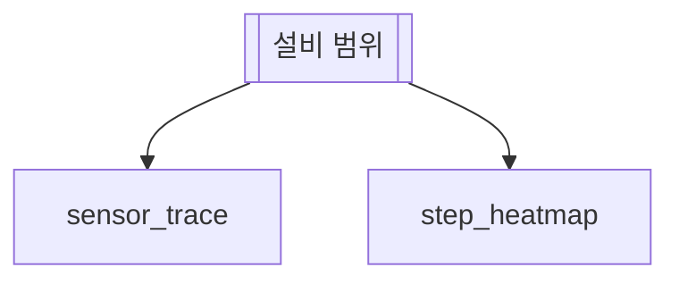

# 센서 트렌드

## 한 줄 설명

설비 센서 값의 시간 추이를 그래프로 본다.

## 언제 호출되는가?

설비 센서 값이 기간 동안 어떻게 움직였는지 보고 싶다.

## 데이터



### sensor_trace — 센서 트렌드

센서마다 값을 시간 순으로 본다.

```sql
select ts, snsr_id, snsr_type_cd, value from fdc_trace
where eqp_id = :eqp_id and ts between :start_time and :end_time
```

```chart
kind   = line
x      = ts
y      = value
series = snsr_id
facet  = snsr_type_cd
```

### step_heatmap — 스텝별 센서 평균

```sql
select step_id, snsr_id, avg_value from fdc_step_summary where eqp_id = :eqp_id
```

```chart
kind  = heatmap
x     = step_id
y     = snsr_id
value = avg_value
title = 스텝 × 센서 평균
```
