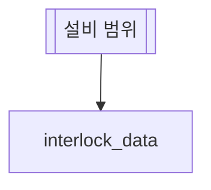

# 인터락 발생 분석

## 한 줄 설명

기간 안의 인터락 발생 내역을 본다.

## 데이터



### interlock_data — 인터락 발생 내역

```sql
select act_time, interlock_id, interlock_name
from INTERLOCK_DATA where eqp_id = :eqp_id and act_time between :start_time and :end_time
```
