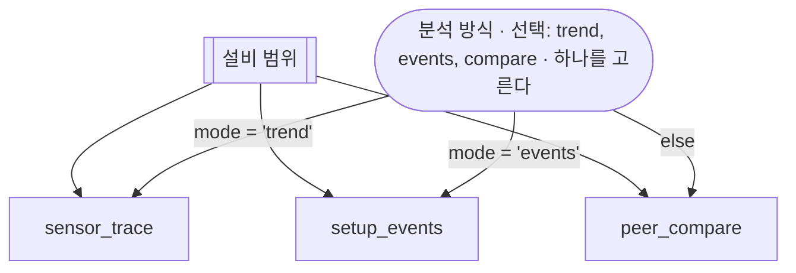

# 분석 방식 고르기

## 한 줄 설명

사용자가 고른 분석 방식으로 센서 추이 · 셋업 이벤트 · 동종 비교 가운데 하나를 본다.

## 언제 호출되는가?

설비의 이상을 어떤 방식으로 볼지 사용자가 고른다.

## 데이터



### sensor_trace — 센서 추이

```sql
select act_time, sensor_value from SENSOR_TRACE where eqp_id = :eqp_id
```

### setup_events — 셋업 이벤트

```sql
select event_time, event_name from SETUP_EVENTS where eqp_id = :eqp_id
```

### peer_compare — 동종 설비 비교

```sql
select peer_eqp_id, avg_value from PEER_COMPARE where eqp_id = :eqp_id
```
