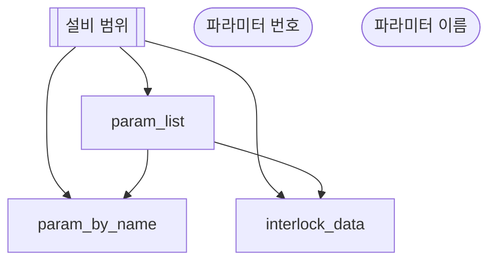

# 인터락 파라미터 분석

## 한 줄 설명

인터락이 걸린 파라미터의 발생 내역을 본다.

## 언제 호출되는가?

인터락이 걸린 파라미터의 발생 내역을 보고 싶다.
파라미터 이름만 알고 번호는 모른다.

## 데이터



### param_list — 파라미터 목록

```sql
select param_index, param_name, subitem, unit from PARAM_INFO where eqp_id = :eqp_id
```

### param_by_name — 이름으로 번호 찾기

```sql
select param_index, param_name, subitem, unit from PARAM_INFO where eqp_id = :eqp_id and param_name = :param_name
```

### interlock_data — 인터락 발생 내역

```sql
select act_time, interlock_id, interlock_name, step_id, lot_id, duration_s
from INTERLOCK_DATA where eqp_id = :eqp_id and param_index = :param_index
```
