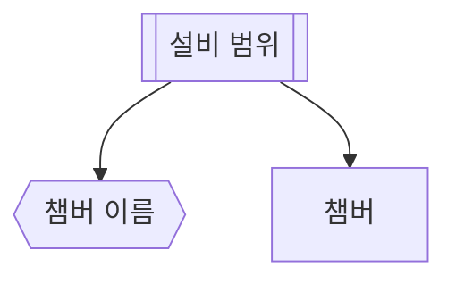

# 나가는 간선 없는 변환

## 한 줄 설명

나가는 간선 없는 변환 표본.

## 데이터



### m — 챔버 이름

```map
ch = eqp_id
```

### chamber — 챔버

```sql
select chamber_id, chamber_name, upper_limit, value
from fdc_chamber where eqp_id = :eqp_id
```
