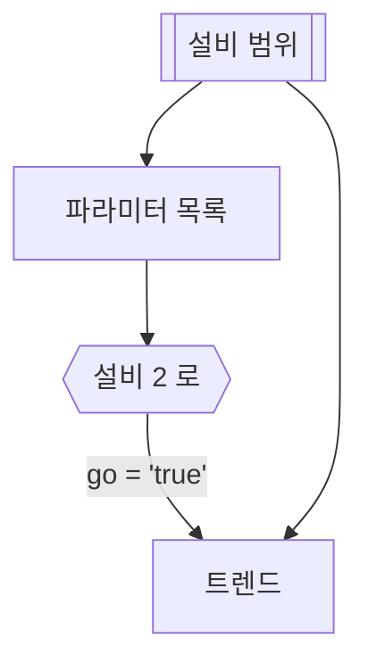

# 설비 2 로 트렌드

## 한 줄 설명

설비 2 로 트렌드 표본.

## 데이터



### param_list — 파라미터 목록

```sql
select param_index, param_name from fdc_param where eqp_id = :eqp_id
```

### cross — 설비 2 로

```map
go          = $eqp.index == 1
param_index = $eqp.index == 1 ? $eqp[0].param_index : param_index
```

### trend — 트렌드

```sql
select time, value from fdc_trend
where eqp_id = :eqp_id and param_index = :param_index
and time between :start_time and :end_time
```
