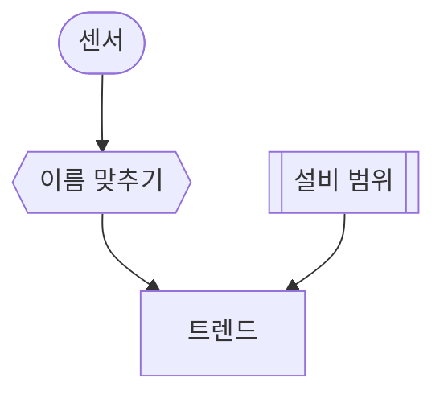

# 센서 트렌드

## 한 줄 설명

센서 트렌드 표본.

## 데이터



### to_trend — 이름 맞추기

```map
param_id = snsr_id
```

### trend — 트렌드

```sql
select time, value from fdc_sensor_trend
where eqp_id = :eqp_id and param_id = :param_id
and time between :start_time and :end_time
```
