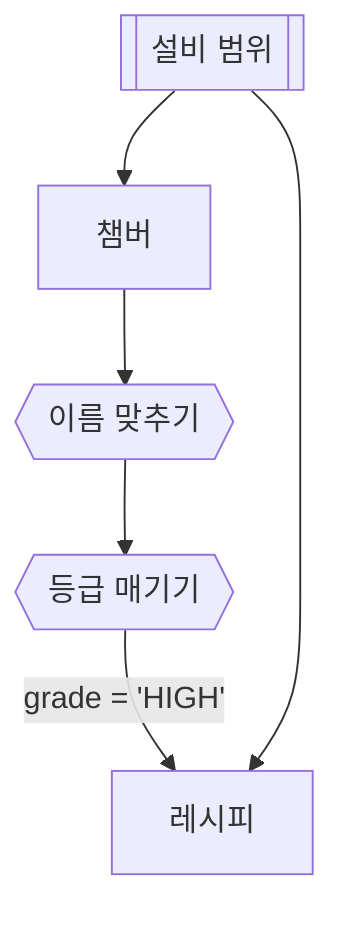

# 변환 둘

## 한 줄 설명

변환 둘 표본.

## 데이터



### chamber — 챔버

```sql
select chamber_id, chamber_name, upper_limit, value
from fdc_chamber where eqp_id = :eqp_id
```

### first — 이름 맞추기

```map
ch_id = chamber_id
limit_hi = upper_limit * 1.1
```

### second — 등급 매기기

```map
grade = value > limit_hi ? "HIGH" : "OK"
```

### recipe — 레시피

```sql
select recipe_id from fdc_recipe
where ch_id = :ch_id and grade = :grade
and start_time between :start_time and :end_time
```
