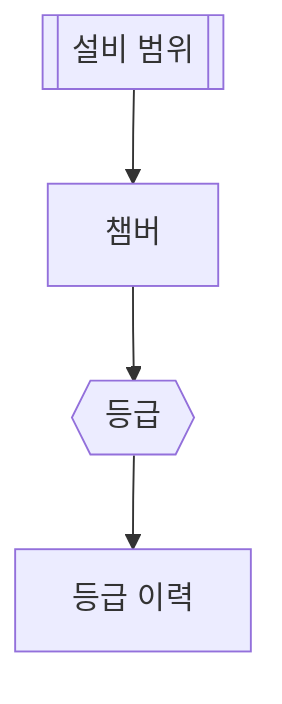

# 등급 셋

## 한 줄 설명

등급 셋 표본.

## 데이터



### chamber — 챔버

```sql
select chamber_id, chamber_name, upper_limit, value
from fdc_chamber where eqp_id = :eqp_id
```

### grade_of — 등급

```map
grade = value > upper_limit * 1.1 ? "HIGH" : value > upper_limit ? "WARN" : "OK"
```

### graded — 등급 이력

```sql
select grade, act_time from fdc_grade_hist where grade = :grade
```
