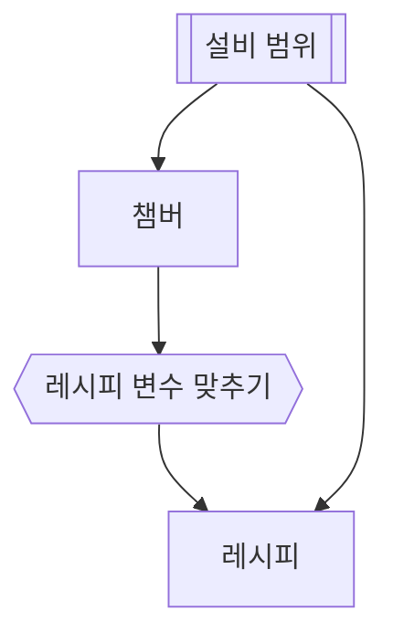

# 레시피 변수 맞추기

## 한 줄 설명

레시피 변수 맞추기 표본.

## 데이터



### chamber — 챔버

```sql
select chamber_id, chamber_name, upper_limit, value
from fdc_chamber where eqp_id = :eqp_id
```

### to_recipe — 레시피 변수 맞추기

```map
ch_id    = chamber_id
limit_hi = upper_limit * 1.1
grade    = value > upper_limit ? "HIGH" : "OK"
```

### recipe — 레시피

```sql
select recipe_id, recipe_name from fdc_recipe
where ch_id = :ch_id and grade = :grade
and start_time between :start_time and :end_time
```
