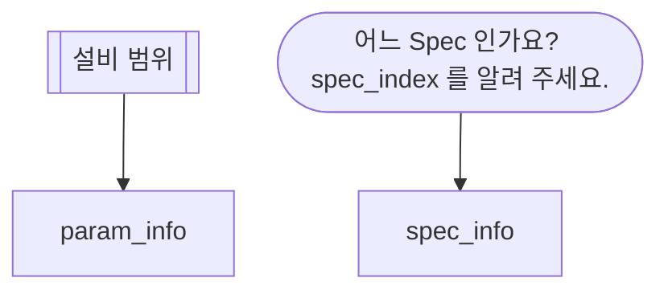

# example_skill.md

## 한 줄 설명

Interlock 이 왜 발생하였는지 설명한다.

## 언제 호출되는가?

인터락이 났는데 왜 났는지 모르겠다.
같은 설비에서 인터락이 자꾸 난다.
Spec Out 이 몇 번 나야 인터락이 걸리는지 알고 싶다.

## 도메인 지식

### DB

#### PARAM_INFO

- IS_TSUM: T/F. TSUM 이면 T, ERD 면 F 이다.

#### SPEC_INFO

- INTERLOCK_TYPE: Interlock 발생 조건을 만족하였을 때 어떤 메시지로 내보낼지 정한다.
- LIMIT_COUNT: SpecOut이 몇 번 일어나면 Interlock 을 발생시킬 것인지.
- GROUP_TYPE: L/W/U. Lot 이면 Lot 마다 Specout 횟수 초기화. W이면 Wafer. U면 User. Spec Check 된 이전 WINDOW_SIZE 만큼의 데이터에서 몇 번의 SpecOut 났는지를 기준.
- WINDOW_SIZE: GROUP_TYPE이 U일 때 WINDOW 크기이다.

### Spec Out

- Spec Out 되면 Interlock 을 발의 시킨다.

## 데이터



### interlock_events — 인터락 발생 내역

- 인터락 발생 내역을 조회할 때 사용한다.
- act_time 과 설비명을 입려으로 한다.

```sql
select act_time,
param_type,
interlock_index
from INTERLOCK_DATA
```

### spec_info — Spec

```sql
select spec_index, interlock_type, limit_count, group_type, window_size
from spec_index
where spec_index = :spec_index
```

### param_info — param 정보

```sql
select eqp_id, param_type, is_tsum
from param_type
where eqp_id = :eqp_id
```
