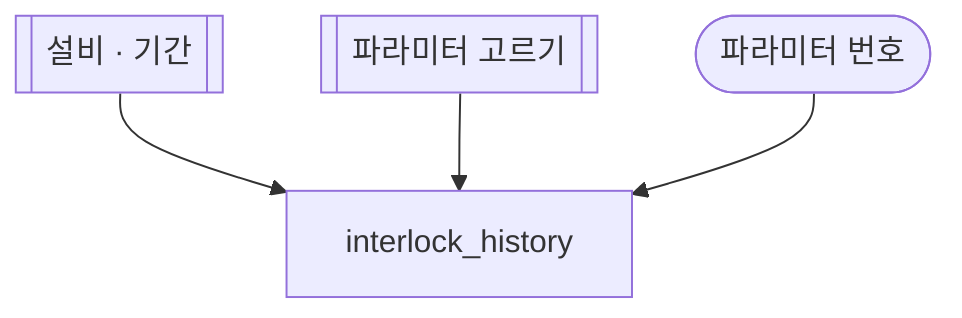

# 인터락 이력

## 한 줄 설명

고른 파라미터의 인터락 이력을 기간 안에서 본다.

## 언제 호출되는가?

파라미터 하나의 인터락 이력을 보고 싶다.

## 데이터



### interlock_history — 인터락 이력

```sql
select act_time, interlock_id from INTERLOCK_HIST where eqp_id = :eqp_id and param_index = :param_index and act_time between :start_time and :end_time
```
