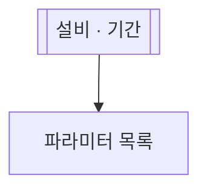

# 파라미터 고르기

## 한 줄 설명

설비의 파라미터 목록에서 하나를 고른다. 다른 md 가 흐름 노드 `param-pick[[파라미터 고르기]]` 로 앞에 세운다.

## 데이터



### param_list — 파라미터 목록

```sql
select param_index, param_name from PARAM_INFO where eqp_id = :eqp_id
```
