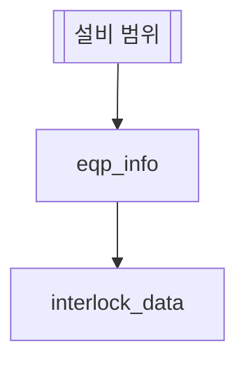

# Interlock 점검

## 한 줄 설명

설비 모델의 Interlock 이력을 본다.

## 데이터



### interlock_data — Interlock 이력

모델별 Interlock 이력.

```sql
select * from fdc_interlock_event where model_id = :model_id and event_time between :start_time and :end_time
```
