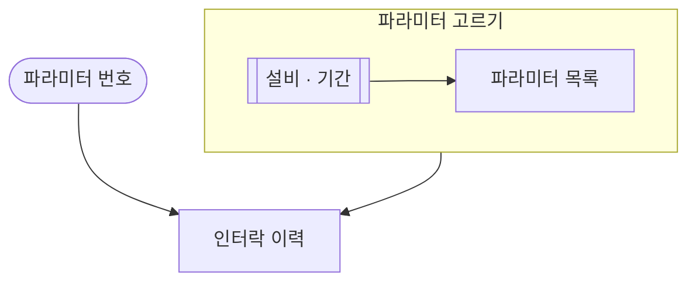

# 파라미터 인터락

## 한 줄 설명

고른 파라미터의 인터락 이력을 기간 안에서 본다. 파라미터 고르기는 subgraph `param_pick` 이다 — 다른 md 가 `param_pick[[파라미터 고르기]]` 로 가리킨다.

## 언제 호출되는가?

파라미터 하나의 인터락 이력을 보고 싶다.

## 데이터



### param_list — 파라미터 목록

```sql
select param_index, param_name from PARAM_INFO where eqp_id = :eqp_id
```

### interlock_history — 인터락 이력

```sql
select act_time, interlock_id from INTERLOCK_HIST where eqp_id = :eqp_id and param_index = :param_index and act_time between :start_time and :end_time
```
