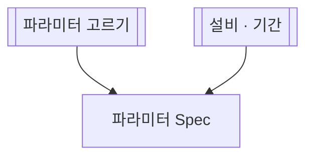

# 파라미터 Spec

## 한 줄 설명

고른 파라미터의 Spec 을 본다. 파라미터 고르기는 다른 md 의 subgraph `param_pick` 을 앞에 세운다.

## 언제 호출되는가?

파라미터 하나의 Spec 을 보고 싶다.

## 데이터



### spec_by_param — 파라미터 Spec

```sql
select spec_low, spec_high from PARAM_SPEC where eqp_id = :eqp_id and param_index = :param_index
```
