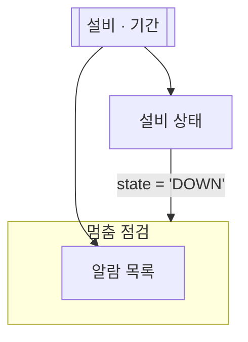

# 멈춤 점검

## 한 줄 설명

설비가 멈췄을 때만 알람 목록을 본다.

## 언제 호출되는가?

설비가 멈췄는지, 멈췄다면 어떤 알람이 났는지 보고 싶다.

## 데이터



### eqp_state — 설비 상태

```sql
select state from EQP_STATE where eqp_id = :eqp_id
```

### alarm_list — 알람 목록

```sql
select alarm_id, alarm_text from ALARM_HIST where eqp_id = :eqp_id
```
